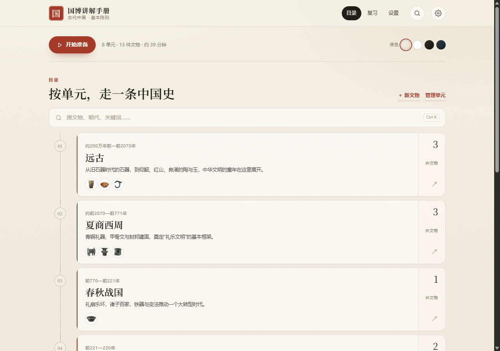
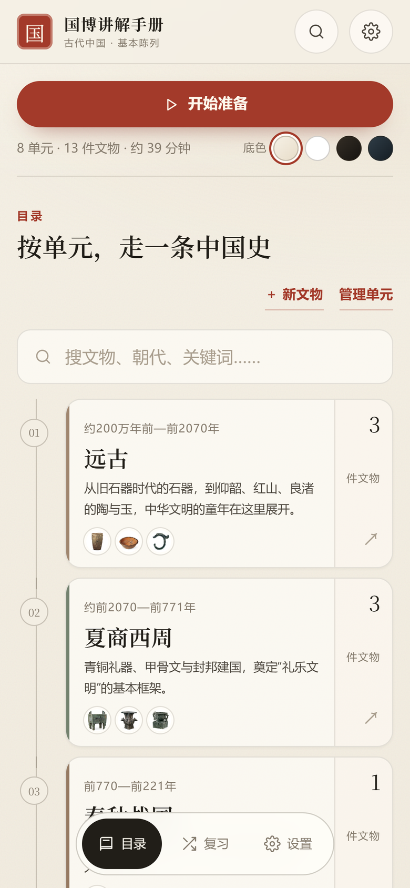
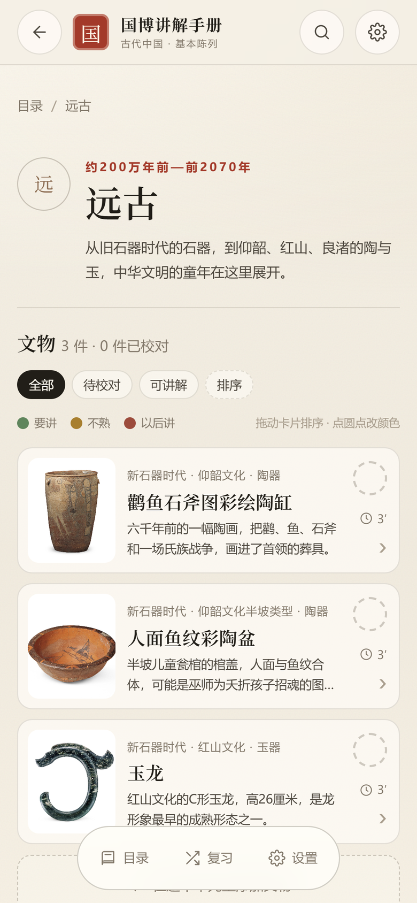
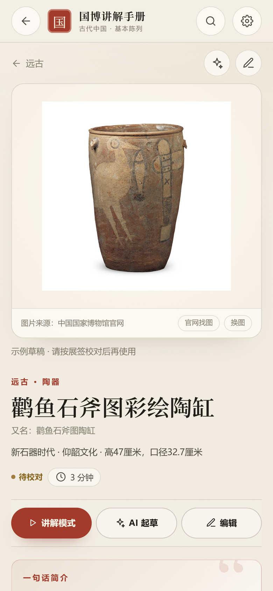
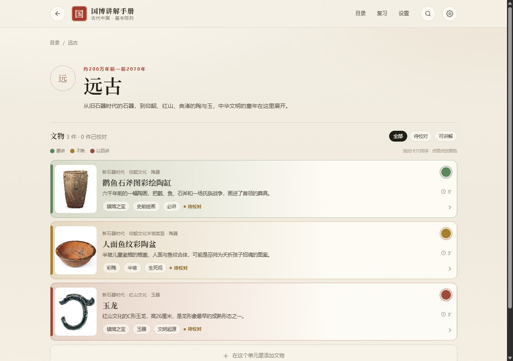
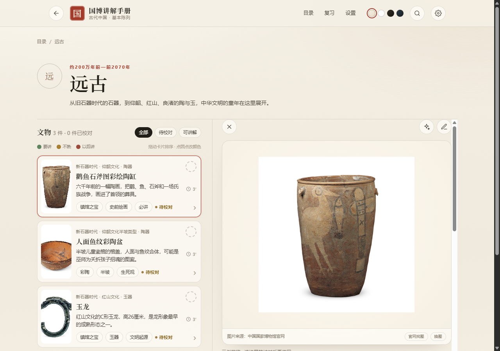
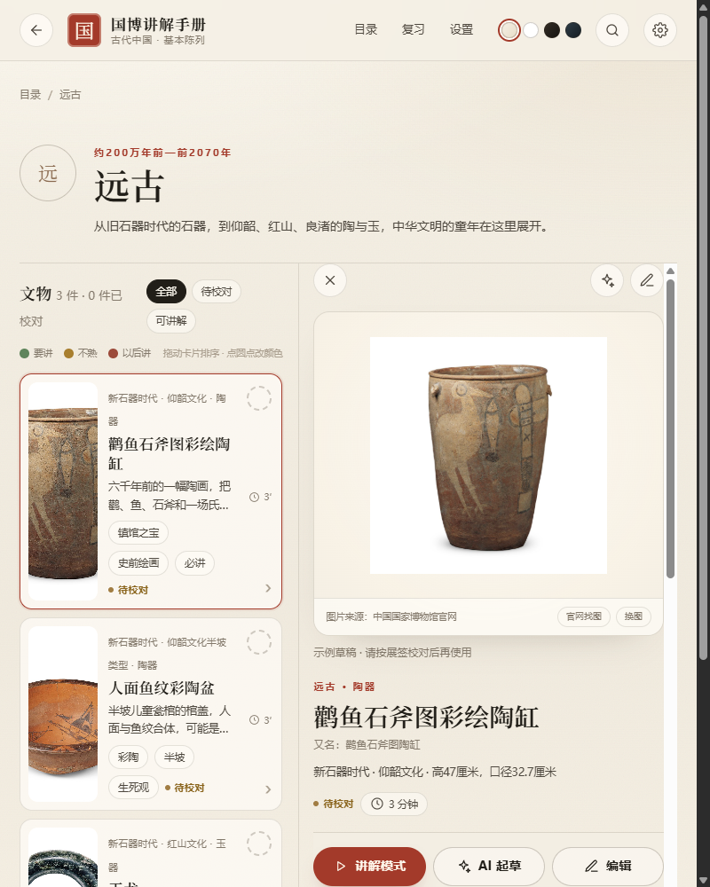
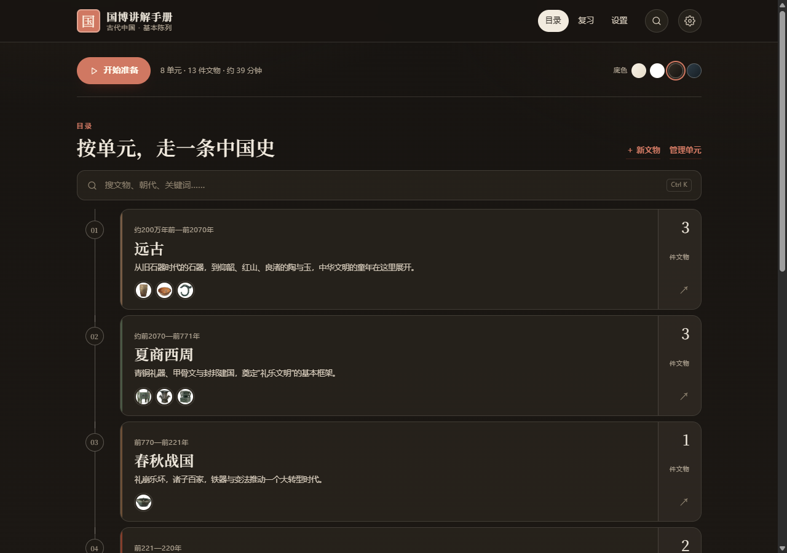

# 国博讲解手册 · 古代中国

一个给讲解员自用的「文物资料 + 讲解故事」工作台。已做成可运行原型：按单元整理文物，AI 按统一格式起草简介和讲解故事，你可以逐字修改；手机网页、离线复习、数据备份都已打通。

> 示例内容为讲解练习草稿，请以展厅说明牌、中国国家博物馆官网及最新研究为准。示例图片来自国博官网，版权归原权利人所有，仅限个人学习使用。

















## 30 秒打开

**方式一：单文件版（最省事）**

双击 `dist/国博讲解手册.html`。这是一个约 5.6 MB 的独立网页，名录图和示例图都打包进去，断网也能看；修改会保存在浏览器本地。

**方式二：本地服务（手机访问 + 自动保存）**

1. 双击 `start.cmd`（需要 Node.js 18+；如果电脑上装了 DeepSeek Harness，脚本会自动找到它自带的 Node）。
2. 浏览器打开 `http://127.0.0.1:4173`。
3. 手机与电脑连同一 Wi-Fi，打开启动窗口里显示的「局域网」地址，例如 `http://192.168.110.37:4173`。
4. 手机浏览器菜单 →「添加到桌面 / 安装应用」。iPhone Safari 用「分享 → 添加到主屏幕」；iPhone 的离线缓存需要 HTTPS，见下一节。

## 手机安装（iPhone / 华为）

- **同一 Wi-Fi**：电脑运行 `start.cmd`，手机打开启动窗口里的「局域网」地址（例如 `http://192.168.110.37:4173`）。
- **iPhone Safari**：分享 → **添加到主屏幕**。HTTP 局域网地址可以使用和添加，但 Service Worker 不注册，**离线缓存不生效**。
- **华为 / Chrome**：浏览器菜单 → **添加到桌面 / 安装应用**；HTTP 下通常可以直接安装。
- **iPhone 要离线**：需要 HTTPS。最省事的是 Tailscale：
  1. 电脑和手机装 Tailscale，登录同一账号；
  2. 电脑运行 `tailscale serve --bg 4173`；
  3. 手机打开它输出的 `https://...ts.net` 地址；
  4. Safari 分享 → 添加到主屏幕，这时离线缓存才会生效。
- 也可以把整个文件夹部署到 Cloudflare Pages / GitHub Pages 等 HTTPS 静态站。
- **数据分设备**：手机和电脑各存各的，换设备用「导出 JSON → 导入」；AI Key 也要在每台设备各填一次。

## 已实现

- **手机版**：iPhone / 华为通用响应式；底部导航、安全区、16px 输入防缩放、手机排序模式；添加、AI、搜索、复习、讲解模式全部保留。
- **三级结构**：单元（远古 / 夏商西周 / 春秋战国 / 秦汉 / 三国两晋南北朝 / 隋唐五代 / 辽宋夏金元 / 明清）→ 文物 → 简介、讲解故事、档案、笔记。
- **可扩展**：随时新增单元、新增文物、编辑、删除、调整单元顺序；不必改代码。
- **顺序与颜色**：桌面可整行拖动排序；手机点「排序」后用每张卡片上的 ↑↓ 调整（iOS Safari 不支持 HTML5 拖动）。卡片右侧圆点循环切换「要讲 / 不熟 / 以后讲」，卡片左侧色条、同色底和边框同步变化，列表顶部有一行图例。
- **底色主题**：首页右上角和内部页面顶栏都能切换宣纸 / 纯白 / 墨色 / 青灰，选择保存在本机；深色主题下卡片、表单、设置页和讲解模式一起变暗。
- **AI 快速添加**：点「AI 快速添加」只输入名称；先在 321 件名录里找，找不到再让 AI 返回 1–3 个候选。确认后上传图片或使用文字占位图，一键生成简介、故事和全部档案字段；也可退回「完整手动填写」。
- **名录检索**：内置 321 件「古代中国」官网重点展品，带官网缩略图、年代、材质、出土和尺寸。添加文物时先看到当前单元的全部候选，顶部搜索框即时过滤；选中后自动填表，也可以「保存并去 AI 起草」一步进入生成。
- **已备稿**：远古前三件（涡纹四系彩陶罐、小口尖底陶瓶、陶猪）已经写好简短简介和导游视角的讲解故事，并换成国博藏品页的 1000px 高清图；名录里显示「已备稿」，选中即自动带出。
- **分栏详情**：宽屏和折叠屏展开时，单元页左边是文物列表、右边直接显示详情；点文物不再跳页，地址会变成 `#/g/单元/a/文物`，刷新和后退都能恢复。窄屏仍走独立详情页。
- **AI 起草**：按固定 JSON 结构输出「一句话简介 + 500–800 字生动故事 + 补齐年代/材质/类别/尺寸/重量/出土」；空着的档案字段会让 AI 补，未知写“未知”；先预览再应用，不覆盖已有资料。
- **可编辑**：所有字段都能改，支持本地上传图片或粘贴图片 URL，支持「馆藏 / 场馆」字段（方便以后扩展到别的馆）。
- **颜色区分**：不做校对状态；只用卡片颜色标记「要讲 / 不熟 / 以后讲」。
- **卡片操作**：右下角「⋯」菜单可编辑或删除；删除后 3 秒内可撤销。长按卡片不会选中文字、不会弹浏览器菜单；手机不启用 HTML5 拖拽，排序用 ↑↓。
- **讲解模式**：全屏大字、按段落分页、计时、字号调节、键盘方向键翻页、屏幕常亮（浏览器支持时）。
- **复习模式**：按单元随机抽题，先回想再翻开；适合上台前过一遍。
- **搜索与备份**：全库搜索；导出 / 导入 JSON（导出不含 API Key）。
- **离线 PWA**：Service Worker 缓存页面和图片；HTTPS 下安装到主屏幕后独立打开、离线复习。
- **示例数据**：8 个单元、13 件国博「古代中国」代表文物，均带国博官网来源链接与官方图片。

## AI 配置

直接调用 DeepSeek 官方接口，不走本地代理。

1. 打开 [DeepSeek API Keys](https://platform.deepseek.com/api_keys) 创建 Key；
2. 手册「设置 → AI 起草」点「用 DeepSeek 官方」；
3. 把 Key 填进去 → 保存设置 → 测试连接；
4. 电脑和手机各填一次，Key 只保存在那台设备的浏览器里。

| 项目 | 说明 |
| --- | --- |
| 接口地址 | `https://api.deepseek.com/chat/completions` |
| API Key | 只保存在本机浏览器；导出备份会自动去掉；换设备 / 清缓存要重填。 |
| 模型 | 默认 `deepseek-flash`；复杂推理时可换 `deepseek-v4-pro`。旧设置里的 `deepseek-chat` 会自动迁移。 |
| 思考模式 | 默认关闭，适合“填空 + 小故事”；设置里可以打开，但会更慢、更贵。 |

按官方当前价格，用 `deepseek-flash` 生成全部 321 件（每件约 2k tokens）大概只要几元人民币；开思考模式或换 `deepseek-v4-pro` 会贵几倍。价格以 [DeepSeek 官方定价](https://api-docs.deepseek.com/quick_start/pricing) 为准。

> 高级：如果以后把手册部署到公网，建议用服务端代理而不是把 Key 放浏览器；仓库里仍保留 `server.mjs` 和 `.env` 方案，但默认不再使用。

没有 Key 也能用：

- 「复制完整提示词」→ 粘贴到任意 AI → 把返回的 JSON 粘回「解析并预览」；
- 「离线搭框架」→ 生成带横线的讲解故事框架，自己填内容。

## 数据与备份

- 数据优先写入 **IndexedDB**，同时尝试写 localStorage 作为兜底。
- 图片：上传的图片会压缩成 data URL 存在本地；以 URL 形式引用的图片只存地址。
- 「设置 → 数据与备份 → 导出备份」会生成 JSON，**不会包含 API Key**。
- 换手机 / 清浏览器缓存前，务必先导出。

## 华为手机

- 网页本身按手机尺寸做了适配，华为浏览器、Chrome、Edge 都可以直接打开。
- PWA 的「添加到桌面」入口和离线能力取决于浏览器版本；如果菜单里没有，仍然可以作为普通网页使用。
- 真要做华为应用市场的原生 App，最省力的路径是用 ArkTS 做一个 WebView 壳，加载现有网页；当前原型先把内容和流程跑通。

## 独立工作区

这个项目现在位于你新建的 DSH 工作区：

```
C:\Users\Yshuo\Desktop\Chinese National Musuem Project
```

它不再放在 `default-workspace` 或 `Documents\guobo-guide`。以后在这个工作区里新开会话，会直接以它为根目录。项目里的 `AGENTS.md` 是给后续会话看的约定：改哪里、怎么测、哪些内容不能动。

## 文件结构

```
Chinese National Musuem Project/
├─ index.html               多文件版入口
├─ app.js                   应用逻辑（原生 JS，无框架）
├─ catalog.js               321 件「古代中国」展品名录（含缩略图路径）
├─ content.js               已备稿的简介与讲解故事（当前 3 条试点）
├─ stories.js               16 篇已有故事的统一改写版（覆盖旧稿）
├─ seed.js                  8 单元 / 13 件示例文物
├─ styles.css               视觉与响应式
├─ manifest.webmanifest     PWA 清单
├─ sw.js                    离线缓存
├─ server.mjs               本地静态服务 + /api/ai 代理
├─ .env.example             DeepSeek Key 配置模板（复制为 .env）
├─ start.cmd                Windows 一键启动
├─ AGENTS.md                给后续 DSH 会话的项目约定
├─ package.json             无依赖的 npm scripts
├─ tools/                   构建、测试、mock、截图脚本
├─ assets/
│  ├─ seed/                 13 张国博官网示例图
│  ├─ catalog/              317 张名录图（前三件高清，其余为官网缩略图）
│  └─ icons/                PWA 图标
├─ dist/
│  └─ 国博讲解手册.html      单文件离线版
├─ release/                 对外压缩包
└─ screenshots/             界面截图
```

## 开发

没有构建步骤。修改 `index.html / app.js / seed.js / stories.js / styles.css` 后刷新即可。

重新生成单文件版（在项目目录下）：

```bash
node tools/build-standalone.mjs
# 或 npm run build
```

重新抓取展品名录（需要联网，数据来自国博官网）：

```bash
node tools/build-catalog.mjs
```

本地服务：

```bash
node server.mjs
# 或 npm start
# 或 PORT=5000 node server.mjs
```

开发脚本说明见 [`tools/README.md`](tools/README.md)。

## 验收记录

- 48/48 条桌面端到端交互检查通过：首页 → 底色切换 → 单元 → 顶部添加 → 无校对 → 不自动聚焦 → 分栏 → 颜色 → 详情 → 讲解模式 → 编辑 → 添加表单精简 → AI 快速添加 → 本地候选 → 配图步骤 → AI 补齐档案 → 名录/已备稿 → 新增文物 → 单元 → 离线框架 → 搜索 → 复习 → DeepSeek 预设 → 拖动排序 → 卡片菜单 → 删除撤销 → 长按拦截。
- 36/36 条 iPhone 视口检查通过（390×844 + 横屏 844×390）：无横向溢出、底部导航、16px 输入、单页详情、顶部添加、卡片菜单、快速添加、无校对、不自动聚焦、排序模式 ↑↓、讲解模式、弹窗高度、安装说明、横屏、折叠屏分栏。
- AI 全链路用本地 mock 接口验证：选名录 → 保存并 AI → 自动生成 → 预览 → 应用 → 写入简介和讲解故事。
- 离线验证：Service Worker 注册成功，断网重载仍能打开页面。
- 单文件版验证：`file://` 打开、编辑、刷新后数据仍在。
- 布局验证：桌面 1280 / 1440；iPhone 390×844、横屏 844×390；华为折叠屏 800 宽。真机 Safari 与 PWA 安装仍需在设备上确认。

## 在 GitHub Pages 上线

按 [`DEPLOY.md`](DEPLOY.md) 操作：GitHub Desktop 发布公开仓库 → Settings → Pages → Deploy from a branch → `main` / root → iPhone Safari 添加到主屏幕。

装好后 GitHub Pages 只负责首次安装和更新；日常打开、添加、复习都从手机缓存运行，电脑可以关机。

## 许可证

- 代码：MIT，见 [`LICENSE`](LICENSE)。
- 国博官网图片：版权归原权利人，仅限个人学习与讲解准备，不在 MIT 范围内，不得商用或公开再分发；详见 [`NOTICE.md`](NOTICE.md)。
- 如果公开仓库包含 `assets/` 或 `screenshots/`，等于公开再分发这些图片；介意的话先移除图片，或改用私有部署。

## 下一步建议

1. 把 13 件示例换成你实际讲解的路线，逐条按展签核对。
2. 增加「讲解路线 / 顺序 / 每站停留时间」，从目录一键生成当天动线。
3. 增加录音回听与自评，练节奏和口头禅。
4. 需要多设备同步时，再接云数据库和图片存储（当前是单机优先）。
5. 需要上架华为应用市场时，再做 ArkTS WebView 壳或原生重写。
